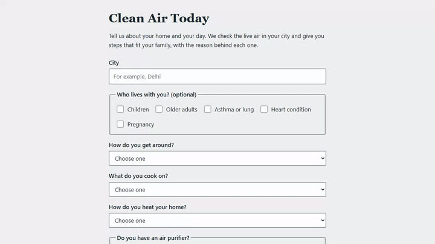

# Clean Air Today: Urban Air Quality Assistant

**Live demo:** https://clean-air-today.vercel.app/  
**Demo Video:** [Watch MP4 Demo](./recordings/clean_air_today_demo.mp4)



**Vertical:** Challenge 6, Urban Air Quality Assistant. Persona: a family or community in a smoggy city in winter.

## What it does

Enter a city plus a few lifestyle facts (household members, commute, cooking fuel, heating, purifier). The app fetches the city's live US AQI and PM2.5 and returns prioritised steps in three groups: **daily routine**, **indoor air** and **cleaner alternatives**. Every step explains _why it matters_, so people see the direct impact of each choice.

## Approach and logic

1. **Live data:** Open-Meteo geocoding and air-quality APIs (no key needed), validated at runtime and cached for 10 minutes.
2. **Decision engine:** a declarative rules table (`src/lib/rules.ts`) maps AQI severity and the household profile to actions. It is pure and deterministic, so advice is reproducible and cannot be hallucinated.
3. **GenAI layer (optional):** Gemini turns the vetted steps into a short, warm summary. It only sees structured facts, never free user text. If the key is missing or the call fails, the app still returns full advice.

## Architecture

```
src/
  app/            page, layout, API route (thin HTTP adapter), proxy.ts (per-request CSP nonce)
  components/     ProfileForm, ResultPanel, AqiGauge (presentational)
  hooks/          useAdvice (request state machine, cancels stale requests)
  lib/
    aqi.ts        EPA bands and Severity constants
    rules.ts      decision table          advice.ts   pure advice builder
    airQuality.ts upstream client + guards gemini.ts  prompt + safe Gemini call
    adviceService.ts orchestration        http.ts     IP, origin, content-type, body limit
    validate.ts   input allow-listing     csp.ts      CSP builder
tests/            unit, route and component tests (axe-core accessibility checks)
```

## Quality bar

| Area              | Evidence                                                                                                                                                                                                                                                                                                                                                                        |
| ----------------- | ------------------------------------------------------------------------------------------------------------------------------------------------------------------------------------------------------------------------------------------------------------------------------------------------------------------------------------------------------------------------------- |
| Code quality      | Strict TypeScript, ESLint (Next config) and Prettier, small single-purpose modules, no magic numbers, dependency injection for I/O                                                                                                                                                                                                                                              |
| Security          | Allow-list validation; 2 KB byte-limited body; same-origin and JSON-only checks; per-IP rate limit; runtime validation of upstream JSON; secrets only in env and sent in headers; no user text in LLM prompts; **nonce-based CSP with no `unsafe-inline` scripts or styles in production**; HSTS, frame, referrer and permissions headers; `npm audit` clean and enforced in CI |
| Efficiency        | 10-minute upstream cache, 5 s / 8 s timeouts, 300-token LLM cap, request cancellation, rules evaluated against a single precomputed severity                                                                                                                                                                                                                                    |
| Testing           | `npm run verify` runs lint, format check, typecheck and 77 tests with enforced coverage thresholds (90% lines); CI runs it on every push                                                                                                                                                                                                                                        |
| Accessibility     | Labelled controls and hints, fieldsets, focus moves to results and errors, `role=alert` / `role=status`, skip link, 44 px targets, text plus colour for AQI, dark mode, reduced motion; axe-core WCAG 2.1 A/AA tests                                                                                                                                                            |
| Problem alignment | Location-aware, lifestyle-tailored routines, indoor hacks and sustainable alternatives, each with an impact explanation                                                                                                                                                                                                                                                         |

## Run

```bash
npm install
cp .env.example .env.local   # optional: add GEMINI_API_KEY
npm run dev                  # http://localhost:3000
npm run verify               # lint + format + types + tests with coverage
```

Deploy on Vercel: import the repo, optionally set `GEMINI_API_KEY`, deploy.

## Assumptions and limits

- AQI uses the US EPA scale; a city name resolves to the first geocoding match.
- Guidance is general information, not medical advice.
- The rate limiter is per serverless instance; use a shared store (for example Upstash Redis) at scale.
- The page renders dynamically so each response can carry its own CSP nonce.
